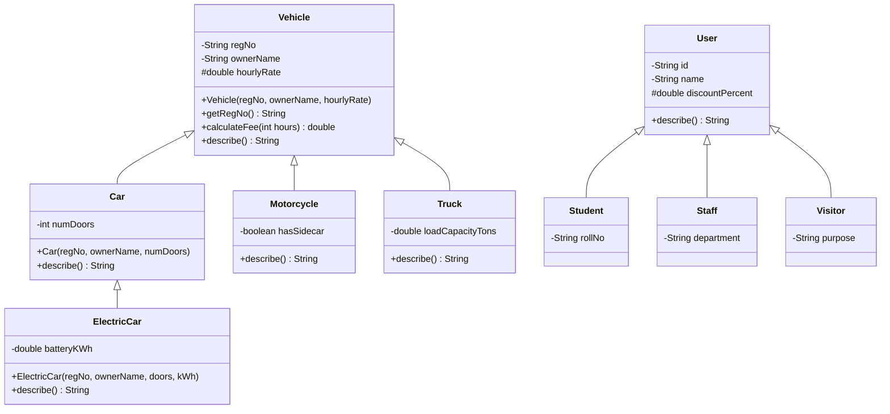

# Task 6 – Design the Inheritance Hierarchy (Smart Parking Lot)

**Bloom's level:** K4 – Analyse  |  **Language:** Java 17+ (tested on 21)

## 1. Files

| File | Role |
|---|---|
| `Vehicle.java` | Superclass: `regNo`, `ownerName`, `hourlyRate`, `calculateFee()`, `describe()` |
| `Car.java` | `Car extends Vehicle` – adds `numDoors` |
| `ElectricCar.java` | `ElectricCar extends Car` – adds `batteryKWh` |
| `Motorcycle.java`, `Truck.java` | Other direct subclasses of `Vehicle` |
| `User.java`, `Student.java`, `Staff.java`, `Visitor.java` | User hierarchy |
| `VehicleType.java`, `VehicleC.java` | **Alternative design** (composition) |
| `Task6Demo.java` | Runs everything and prints the constructor trace |

**Run:**
```bash
javac *.java
java Task6Demo
```

## 2. UML class diagram



Plain-text version (if your viewer does not render Mermaid):

```
              Vehicle                                   User
   +-------------+--------------+                +-------+-------+
   |             |              |                |       |       |
  Car        Motorcycle       Truck           Student   Staff  Visitor
   |
 ElectricCar
```

### 2.1 Class diagram specification (use this to draw it in Umbrello or any UML tool)

Notation: `-` private, `#` protected, `+` public.

**Vehicle hierarchy**

| Class | Attributes | Operations |
|---|---|---|
| **Vehicle** | `- regNo : String`<br>`- ownerName : String`<br>`# hourlyRate : double` | `+ Vehicle(regNo : String, ownerName : String, hourlyRate : double)`<br>`+ getRegNo() : String`<br>`+ getOwnerName() : String`<br>`+ getHourlyRate() : double`<br>`+ calculateFee(hours : int) : double`<br>`+ describe() : String` |
| **Car** | `- numDoors : int` | `+ Car(regNo : String, ownerName : String, numDoors : int)`<br>`# Car(regNo : String, ownerName : String, numDoors : int, rate : double)`<br>`+ getNumDoors() : int`<br>`+ describe() : String` |
| **ElectricCar** | `- batteryKWh : double` | `+ ElectricCar(regNo : String, ownerName : String, numDoors : int, batteryKWh : double)`<br>`+ getBatteryKWh() : double`<br>`+ describe() : String` |
| **Motorcycle** | `- hasSidecar : boolean` | `+ Motorcycle(regNo : String, ownerName : String, hasSidecar : boolean)`<br>`+ hasSidecar() : boolean`<br>`+ describe() : String` |
| **Truck** | `- loadCapacityTons : double` | `+ Truck(regNo : String, ownerName : String, loadCapacityTons : double)`<br>`+ getLoadCapacityTons() : double`<br>`+ describe() : String` |

**User hierarchy**

| Class | Attributes | Operations |
|---|---|---|
| **User** | `- id : String`<br>`- name : String`<br>`# discountPercent : double` | `+ User(id : String, name : String, discountPercent : double)`<br>`+ getId() : String`<br>`+ getName() : String`<br>`+ getDiscountPercent() : double`<br>`+ describe() : String` |
| **Student** | `- rollNo : String` | `+ Student(id : String, name : String, rollNo : String)`<br>`+ getRollNo() : String`<br>`+ describe() : String` |
| **Staff** | `- department : String` | `+ Staff(id : String, name : String, department : String)`<br>`+ getDepartment() : String`<br>`+ describe() : String` |
| **Visitor** | `- purpose : String` | `+ Visitor(id : String, name : String, purpose : String)`<br>`+ getPurpose() : String`<br>`+ describe() : String` |

**Relationships**

| # | From (child) | To (parent) | Umbrello tool | Meaning |
|---|---|---|---|---|
| 1 | Car | Vehicle | Generalization | Car extends Vehicle |
| 2 | ElectricCar | Car | Generalization | multilevel |
| 3 | Motorcycle | Vehicle | Generalization | hierarchical |
| 4 | Truck | Vehicle | Generalization | hierarchical |
| 5 | Student | User | Generalization | hierarchical |
| 6 | Staff | User | Generalization | hierarchical |
| 7 | Visitor | User | Generalization | hierarchical |

Click the **child first**, then the **parent**, so the hollow triangle lands on the parent.

**Alternative (composition-style) design, drawn as a separate diagram**

| Class | Attributes | Operations |
|---|---|---|
| **VehicleType** | `- name : String`<br>`- hourlyRate : double` | `+ VehicleType(name : String, hourlyRate : double)`<br>`+ getName() : String`<br>`+ getHourlyRate() : double` |
| **VehicleC** | `- regNo : String`<br>`- ownerName : String`<br>`- type : VehicleType` | `+ VehicleC(regNo : String, ownerName : String, type : VehicleType)`<br>`+ calculateFee(hours : int) : double`<br>`+ describe() : String` |

Relationship: `VehicleC` → `VehicleType`, **Aggregation** (hollow diamond at `VehicleC`), multiplicity `*` at `VehicleC` and `1` at `VehicleType`, role name `type`. Hollow-diamond aggregation is used because one `VehicleType` is shared by many vehicles and outlives them; a plain Association with multiplicities is also acceptable.

### 2.2 Drawing it in Umbrello (steps)

1. *Diagram → New → Class Diagram*.
2. Add a class for each row of the tables above.
3. Right-click each class → *Properties* → add the attributes and operations, with the visibility shown.
4. Draw each relationship with the **Generalization** tool (child first, then parent).
5. In the class display options tick *Show attributes*, *Show operations*, *Show visibility* and *Show signatures*.
6. Draw the alternative design in a **second** diagram with the **Aggregation** tool.
7. Export with *Diagram → Export as Picture* and paste it into your report.

Only the **class diagram** is required for Task 6. Use case and activity diagrams are not part of this task.

## 3. Superclass, subclasses and type of inheritance

| Hierarchy | Superclass | Subclasses | Type of inheritance |
|---|---|---|---|
| Vehicles | `Vehicle` | `Car`, `Motorcycle`, `Truck` | **Hierarchical** (several subclasses, one parent) |
| Vehicles | `Car` | `ElectricCar` | **Multilevel** (`Vehicle → Car → ElectricCar`) |
| Users | `User` | `Student`, `Staff`, `Visitor` | **Hierarchical** |

The whole vehicle tree is therefore a combination of hierarchical and multilevel inheritance. Java classes only have **single** direct inheritance (one `extends`), so each class has exactly one parent.

**Why inherit?** Every subclass passes the "is-a" test (a Car *is a* Vehicle, an ElectricCar *is a* Car) and shares the same identity data (`regNo`, `ownerName`) and the same behaviour contract (`calculateFee`). The user types share `id`, `name` and a discount; they differ only in one extra attribute each, so the hierarchy is also appropriate for users.

## 4. What is inherited and what is added

| Class | Inherited | Added / changed |
|---|---|---|
| `Vehicle` | – (implicitly `Object`) | `regNo`, `ownerName`, `hourlyRate`, getters, `calculateFee()`, `describe()` |
| `Car` | everything public/protected from `Vehicle` | `numDoors`, getter; overrides `describe()` |
| `ElectricCar` | everything from `Car` **and** `Vehicle` | `batteryKWh`, getter; overrides `describe()` |
| `Motorcycle` | from `Vehicle` | `hasSidecar` |
| `Truck` | from `Vehicle` | `loadCapacityTons` |
| `Student` / `Staff` / `Visitor` | `id`, `name`, `discountPercent`, `describe()` | `rollNo` / `department` / `purpose` |

Notes:
* `private` members (`regNo`, `ownerName`) **exist** in every subclass object but are reachable only through the getters.
* `protected` (`hourlyRate`, `discountPercent`) is visible to subclasses.
* **Constructors are never inherited**; each subclass writes its own and calls the parent's.

## 5. How `super` is used

| Use | Example in code | Purpose |
|---|---|---|
| **Constructor** `super(...)` | `Car`: `super(regNo, ownerName, 20.0);` | Initialise the inherited part. Must be the **first statement**. |
| **Method** `super.m()` | `Car.describe()`: `return super.describe() + " doors=" + numDoors;` | Reuse the parent's behaviour and extend it, instead of copying code. |
| **Field** `super.f` | `super.hourlyRate` (same as `hourlyRate` unless a subclass declares a field with the same name that *hides* it) | Disambiguate a hidden field. Not needed here because no field is hidden, which is the recommended practice. |

If a constructor has no explicit `super(...)`, Java inserts `super()`; since `Vehicle` has no no-arg constructor, every subclass **must** call `super(...)` explicitly, otherwise it will not compile.

`Car` also has a protected 4-argument constructor so `ElectricCar` can pass its own (cheaper) rate up the chain: `ElectricCar → super(regNo, owner, doors, 15.0) → Car → super(regNo, owner, rate) → Vehicle`.

## 6. Constructor execution order – `new ElectricCar("TN01EV1234", "Asha", 4, 60.0)`

Constructors run **top-down** (superclass first), even though the call starts at the bottom.

```
new ElectricCar(...)
 │ 1. ElectricCar ctor entered → first statement is super(...)  ───────┐
 │                                                                     ▼
 │                                        2. Car ctor entered → first statement is super(...) ──┐
 │                                                                                              ▼
 │                                                         3. Vehicle ctor entered (super() → Object())
 │                                                            body runs: sets regNo, owner, rate   ← PRINTS [1]
 │                                        4. Vehicle returns → Car body runs: sets numDoors        ← PRINTS [2]
 │ 5. Car returns → ElectricCar body runs: sets batteryKWh                                        ← PRINTS [3]
 ▼
 object fully constructed
```

Actual program output:

```
=== 1. Constructor trace: new ElectricCar(...) ===
  [1] Vehicle constructor    -> regNo=TN01EV1234
  [2] Car constructor        -> doors=4
  [3] ElectricCar constructor-> battery=60.0 kWh
```

Order: `Object()` → `Vehicle` → `Car` → `ElectricCar`. `Object()` is silent, and the three printed lines show the rest. Reason: a subclass body may use inherited state, so the inherited part must be initialised first.

## 7. Full program output

```
=== 4. Polymorphic list of Vehicles (super.describe() chain) ===
ElectricCar[reg=TN01EV1234, owner=Asha, rate=15.0/hr] doors=4 battery=60.0kWh   fee(3h)=45.00
Car[reg=TN09AB1111, owner=Ravi, rate=20.0/hr] doors=4                           fee(3h)=60.00
Motorcycle[reg=TN22CD2222, owner=Kiran, rate=10.0/hr] sidecar=false             fee(3h)=30.00
Truck[reg=TN33EF3333, owner=Meena, rate=50.0/hr] capacity=8.5t                  fee(3h)=150.00
```
`ElectricCar.describe()` calls `Car.describe()`, which calls `Vehicle.describe()`, so each level adds its own part (`doors=`, then `battery=`).

## 8. Alternative concept – composition (`Vehicle has-a VehicleType`)

UML: shown as an **aggregation/association** line from `VehicleC` to `VehicleType` (diamond at `VehicleC`) instead of an inheritance triangle.

```java
class VehicleType { String name; double hourlyRate; }
class VehicleC    { String regNo, ownerName; VehicleType type;
                    double calculateFee(int h){ return type.getHourlyRate()*Math.max(1,h); } }
```
Implemented in `VehicleType.java` / `VehicleC.java` and demonstrated in section 6 of the demo output (a `Bus` is added without writing any class).

### 8.1 Cost of adding a new vehicle type (e.g. Bus)

| | Inheritance | Composition |
|---|---|---|
| New classes | **1** (`Bus extends Vehicle`) | **0** |
| Work | Write class + constructor, recompile | `new VehicleType("Bus", 80)` – one line of data; can be loaded from a file/DB with no recompile |
| Existing classes modified | 0 (open/closed) | 0 |
| Type-specific *extra fields* (e.g. `loadCapacityTons`) | Natural – just add fields | Awkward – needs a map of attributes or a subclass anyway |
| Type-specific *behaviour* (truck cap, EV charging) | Natural – override | Needs a `FeeRule` strategy object inside `VehicleType` (still composition, but more code) |

### 8.2 Time to compute a fee

* **Inheritance:** a virtual call (`vtable` lookup) + one multiplication → **O(1)**. If the subclass chains to its parent with `super.calculateFee()`, cost is **O(d)** where *d* is the depth of the hierarchy (here ≤ 3), which is a constant.
* **Composition:** one field load (`type`), one method call (`getHourlyRate`), one multiplication → **O(1)**.

Both are O(1) and independent of *k*, the number of vehicle types. In practice the difference is nanoseconds.

### 8.3 Space per vehicle object (64-bit HotSpot, compressed oops, approx.)

| | Layout | Size |
|---|---|---|
| **Inheritance** `Car` | header 12 + `regNo` 4 + `ownerName` 4 + `hourlyRate` 8 + `numDoors` 4 | ≈ 32 B (after 8-byte alignment) |
| **Composition** `VehicleC` | header 12 + `regNo` 4 + `ownerName` 4 + `type` 4 | ≈ 24 B |

Composition stores the rate **once per type** (shared `VehicleType`, extra O(k) objects in total) rather than once **per vehicle**, so for *n* vehicles: inheritance = O(n) with a larger constant; composition = O(n + k) with a smaller constant. (Inheritance could also drop the per-object `hourlyRate` by making it a method override, which removes the gap.)

### 8.4 Verdict

Use **inheritance** when types differ in *data and behaviour* (Truck has capacity, ElectricCar has a battery). Use **composition** when types differ only in *values* (a rate) and you want new types to be pure data. Real systems often mix: inherited vehicle classes that hold a composed `FeeRule` strategy.